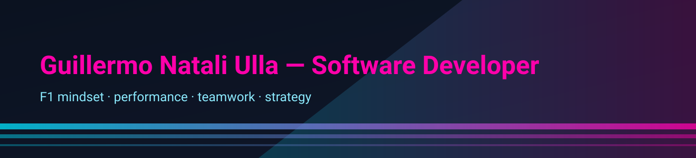
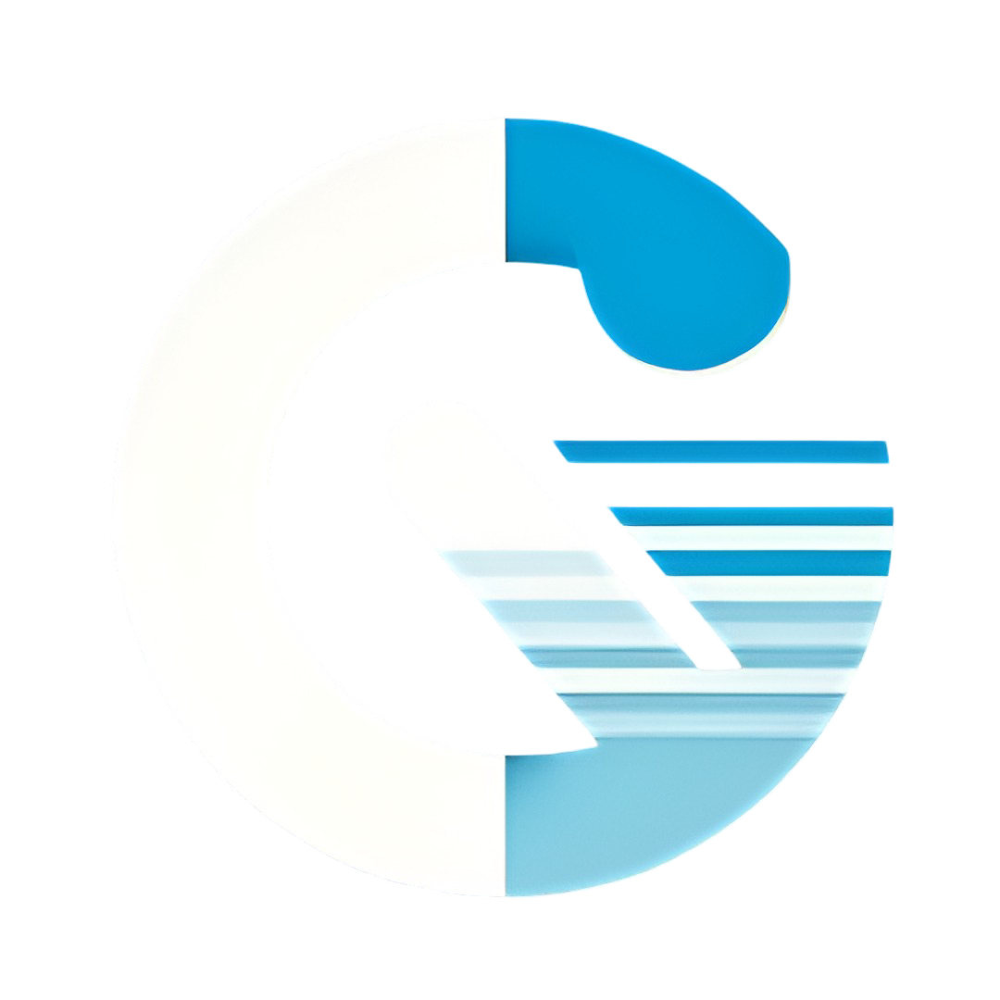

  

  

<h3 align="center">Backend Developer • Full‑stack Enthusiast • DevOps Explorer</h3>

  
  
  
  
  

---

## 📚 Sobre mí

- 🎓 **Técnico Superior en Desarrollo de Software** (graduado).
- 🏫 Actualmente cursando **4º año de Ingeniería en Sistemas** en la **Universidad Abierta Interamericana – UAI Rosario** (turno noche).
- 💻 Backend con **Django**, **Ruby on Rails** y **APIs REST**.
- 🔐 Seguridad, despliegues con **Docker/Nginx** y CI/CD con **GitHub Actions**; bases de datos **PostgreSQL/MySQL/Redis**.
- ⚡ Enfoque en **performance**, **buenas prácticas** y **DX**.

---

## 🛠️ Tech Stack

| | |
|---|---|
| **Backend** |       |
| **Bases de datos** |        |
| **DevOps** |      |
| **Lenguajes** |      |
| **Frontend** |     |

---

## 🚀 Proyectos Destacados

| Proyecto | Qué hace | Stack |
|---|---|---|
| 🌾 [**Gaucho Weather**](https://github.com/guille-nat/Gaucho-Weather) | Pronóstico del tiempo y **riesgo de heladas** para el campo argentino, con alertas 48 h antes. | Python · JavaScript · Docker |
| 🎸 [**Rock & Roll Podcast Service**](https://github.com/guille-nat/rock_and_roll_podcast_service) | API REST que ingesta podcasts desde iTunes a PostgreSQL, extrae paletas de color de las portadas y sirve un catálogo filtrable. | Python · PostgreSQL · Docker |
| 🛒 [**Spree Purchase Recommendations**](https://github.com/guille-nat/spree_purchase_recommendations) | Extensión para Spree con recomendaciones por historial de compras (Redis, Sidekiq, sin N+1). | Ruby on Rails · Redis · Sidekiq |
| 🧾 [**API Compras**](https://github.com/guille-nat/Api_Compras) | API REST con JWT, Swagger/ReDoc y automatización de comprobantes. | Django · DRF · JWT |
| 📟 [**token-bar**](https://github.com/guille-nat/token-bar) | Mod para Claude Code: barra de estado con uso del plan, modelo y estado del repo. | TypeScript |

---

## 🏎️ F1 Vibes

  
  
  

---

## 📊 Stats

  
  

  

---

## 🐍 Snake Contributions

  <picture>
    <source media="(prefers-color-scheme: dark)" srcset="dist/snake-dark.svg" />
    <source media="(prefers-color-scheme: light)" srcset="dist/snake.svg" />
    
  </picture>

> *Se regenera todos los días vía GitHub Actions.*

---

## 📅 Efemérides de la Programación
<!--EFEMERIDES_START-->
No hay efemérides para hoy (10-23). La más cercana es del **09-27**:
- 1983: **Richard Stallman** anuncia el proyecto **GNU**.
<!--EFEMERIDES_END-->

> *Se actualiza automáticamente todos los días vía GitHub Actions.*

---

## 🤝 Conectemos

¿Tenés un proyecto backend, una API o un deploy que necesita una mano? Escribime a
**[guillermonatali22@gmail.com](mailto:guillermonatali22@gmail.com)** o por [LinkedIn](https://www.linkedin.com/in/guillermo-natali-ulla-550469220/).
