

  

  
  
  
  
  

  

## 🏁 Algunas cosas que construí

Sistemas que diseñé y sostengo en producción, más algunos repos abiertos. Los casos completos (problema, decisión y resultado) están en [guillermonatali.com](https://guillermonatali.com/).

  <a href="https://micaskin.com/"></a>

  <a href="https://guillermonatali.com/casos/mensajeria-omnicanal/"></a>
  <a href="https://guillermonatali.com/casos/vps-multi-app/"></a>

  <a href="https://github.com/guille-nat/Gaucho-Weather"></a>
  <a href="https://github.com/guille-nat/spree_purchase_recommendations"></a>

  <a href="https://github.com/guille-nat/Api_Compras"></a>
  <a href="https://github.com/guille-nat/token-bar"></a>

## 🧰 El garage

  

  

## 📊 Telemetría en vivo

  

### 🏙️ El circuito en 3D

  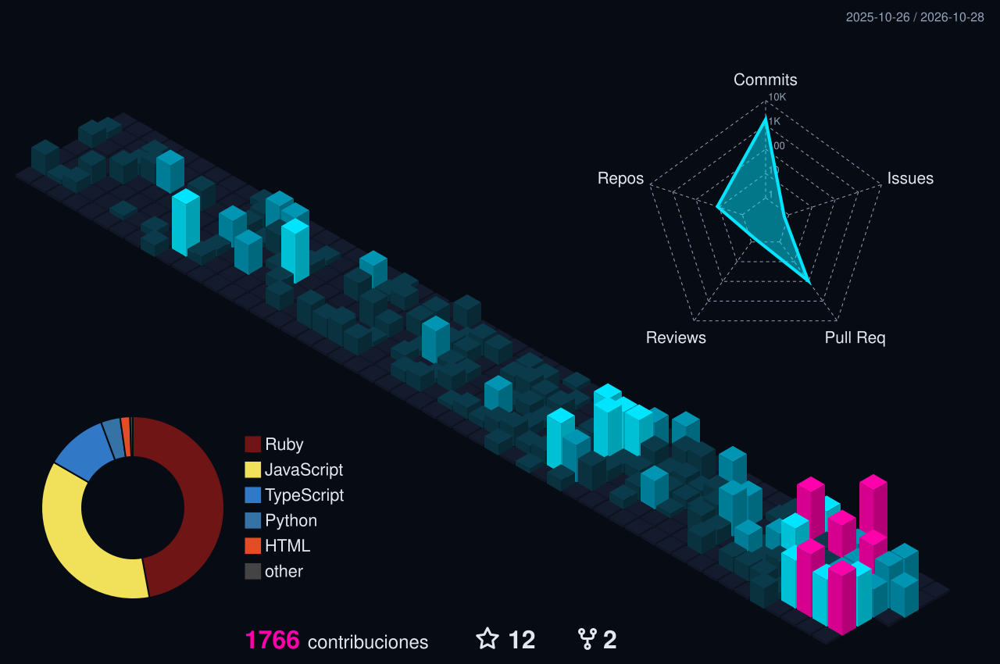

### 🐍 Vuelta de clasificación

  <picture>
    <source media="(prefers-color-scheme: dark)" srcset="dist/snake-dark.svg" />
    <source media="(prefers-color-scheme: light)" srcset="dist/snake.svg" />
    
  </picture>

## 📻 Team radio · Efemérides de la programación

<!--EFEMERIDES_START-->
No hay efemérides para hoy (10-24). La más cercana es del **09-27**:
- 1983: **Richard Stallman** anuncia el proyecto **GNU**.
<!--EFEMERIDES_END-->

Se actualiza solo todos los días con GitHub Actions.

## 🤝 Conectemos

¿Tenés un sistema que tiene que funcionar en producción y sostenerse? Escribime a
**[guille@guillermonatali.com](mailto:guille@guillermonatali.com)** o por [LinkedIn](https://www.linkedin.com/in/guillermo-natali-ulla-550469220/).

  
  

  

